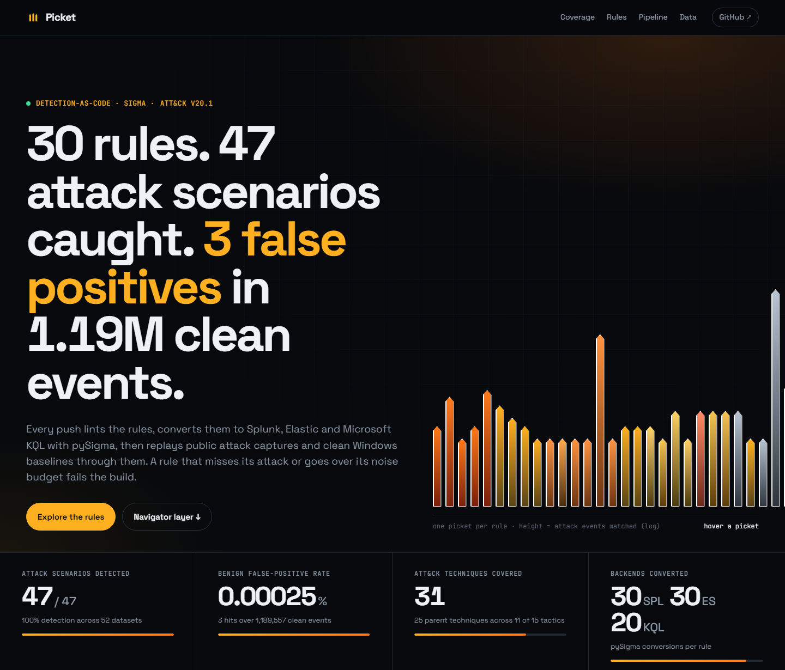
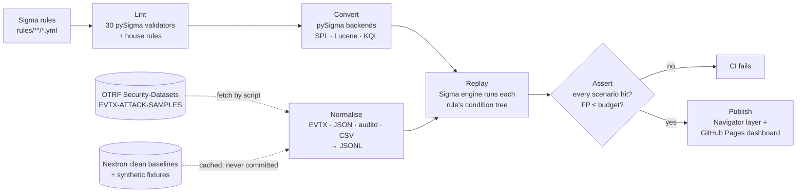
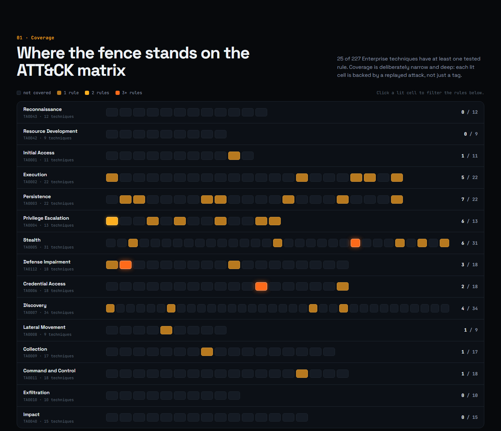
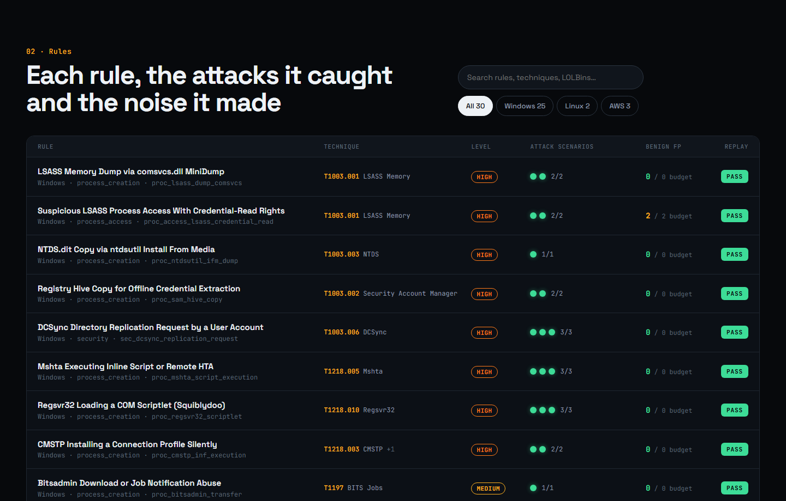
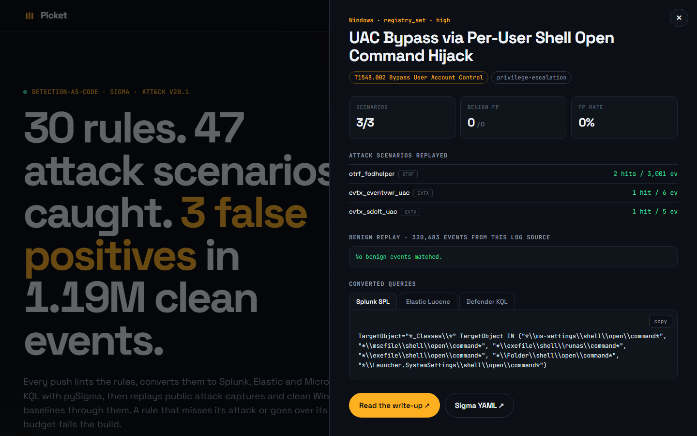

# Picket

**Detection-as-code for Windows, Linux and AWS.** 30 Sigma rules mapped to MITRE ATT&CK v20, each one replayed against real attack telemetry and 1.19 million clean Windows events on every push. A rule that misses its attack, or makes more noise than its budget allows, fails the build.

[](https://github.com/alok-kul5/picket/actions/workflows/ci.yml)
**[Live coverage dashboard →](https://alok-kul5.github.io/picket/)**



## The numbers

| | |
|---|---|
| Rules | **30** (25 Windows, 2 Linux, 3 AWS) |
| Attack scenarios detected | **47 / 47**: 45 public captures plus 2 labelled synthetic fixtures |
| Benign replay | **3 false positives** over **1,189,557** clean events, in 2 rules, both documented and budgeted |
| ATT&CK coverage | **31 techniques** (25 parent techniques) across **11 of 15** Enterprise tactics |
| pySigma conversion | Splunk SPL **30/30** · Elastic Lucene (ECS) **30/30** · Defender XDR KQL **20/30** |
| Replay size | 164,152 attack events + 1,189,557 benign events, about 30 s per run |

KQL is 20/30 because Defender XDR has no table for the Windows Security and System logs, Sysmon process access or WMI events, or for auditd and CloudTrail. The converter reports that per rule instead of hiding it.

## Pipeline



Every push runs [`.github/workflows/ci.yml`](.github/workflows/ci.yml): unit tests → lint → convert → fetch → replay → coverage → deploy to Pages. It also runs weekly, so an upstream dataset or ATT&CK change shows up without a commit.

## How the replay works

- **Rules** are plain Sigma YAML in [`rules/`](rules). Each one has ATT&CK tags, references, false positives and a level, and a write-up in [`docs/rules/`](docs/rules) covering what it detects, the data source, known false positives and tuning notes.
- **Test cases** in [`tests/replay_cases.yml`](tests/replay_cases.yml) list the attack captures each rule must fire on and how many benign hits it may raise (`max_fp`, default 0).
- **The engine** ([`picket/engine.py`](picket/engine.py)) lets pySigma parse each rule and expand its modifiers (`contains`, `endswith`, `all`, `re`, `cidr`, …) into a tree of AND/OR/NOT over field/value leaves. That tree is compiled into Python predicates and run over every event. Using pySigma's parser means the replay tests the same rule semantics the SIEM backends get.
- **Data** is fetched by [`picket/fetch.py`](picket/fetch.py) from the sources in [`datasets/manifest.yml`](datasets/manifest.yml), read in memory and normalised to JSONL in `.cache/`. Only logs are downloaded. No malware sample is fetched or run.
- **Scoring:**
  - **Detection**: a scenario counts as detected when the rule fires at least once on that capture. A rule's detection rate is detected scenarios over mapped scenarios.
  - **False positives**: matches on the benign corpora. The FP rate's denominator is only the benign events from the rule's own log source (for example the 5,992 Sysmon process-creation events, not all 1.19M), so a quiet log source cannot make a rule look better than it is.
  - **Other-scenario hits**: matches on attack captures a rule is not mapped to are reported but not scored. They are usually the same attack chain seen from another angle.

### Tuning loop, with real results

The first replay against clean hosts raised **53 alerts** for the LSASS-access rule alone: Sysmon itself, the Malicious Software Removal Tool and Windows Installer all open LSASS with read rights. Each fix is recorded in the rule's write-up. Two hits were left in on purpose: DropboxUpdate running from `%TEMP%`, because filtering an updater by a user-writable path would let any dropped binary hide behind it. The same happened with Dropbox adding a firewall rule (filtered by a Program Files parent) and Zoom's service (fixed by dropping a too-broad `\AppData\` term). See [the LSASS write-up](docs/rules/proc_access_lsass_credential_read.md) for the full story.

## Screenshots

**ATT&CK heatmap.** Every Enterprise technique by tactic; lit cells are backed by a replayed attack, and clicking one filters the rules.



**Rule explorer.** Each dot is an attack capture the rule caught (a ring marks a synthetic fixture), next to its benign FP count against its budget.



**Rule drawer.** The scenarios replayed, the benign matches and the converted SPL / Lucene / KQL.



## Rules

| Rule | Platform | ATT&CK | Detected | FP / budget |
|---|---|---|---|---|
| [LSASS Memory Dump via comsvcs.dll MiniDump](docs/rules/proc_lsass_dump_comsvcs.md) | Windows | T1003.001 | 2/2 | 0 / 0 |
| [Suspicious LSASS Process Access With Credential-Read Rights](docs/rules/proc_access_lsass_credential_read.md) | Windows | T1003.001 | 2/2 | 2 / 2 |
| [NTDS.dit Copy via ntdsutil Install From Media](docs/rules/proc_ntdsutil_ifm_dump.md) | Windows | T1003.003 | 1/1 | 0 / 0 |
| [Registry Hive Copy for Offline Credential Extraction](docs/rules/proc_sam_hive_copy.md) | Windows | T1003.002 | 2/2 | 0 / 0 |
| [DCSync Directory Replication Request by a User Account](docs/rules/sec_dcsync_replication_request.md) | Windows | T1003.006 | 3/3 | 0 / 0 |
| [Mshta Executing Inline Script or Remote HTA](docs/rules/proc_mshta_script_execution.md) | Windows | T1218.005 | 3/3 | 0 / 0 |
| [Regsvr32 Loading a COM Scriptlet (Squiblydoo)](docs/rules/proc_regsvr32_scriptlet.md) | Windows | T1218.010 | 3/3 | 0 / 0 |
| [CMSTP Installing a Connection Profile Silently](docs/rules/proc_cmstp_inf_execution.md) | Windows | T1218.003, T1548.002 | 2/2 | 0 / 0 |
| [Bitsadmin Download or Job Notification Abuse](docs/rules/proc_bitsadmin_transfer.md) | Windows | T1197 | 1/1 | 0 / 0 |
| [Firewall Rule Added or Firewall Disabled via Netsh](docs/rules/proc_netsh_firewall_allow.md) | Windows | T1686.003 | 1/1 | 0 / 0 |
| [Netsh PortProxy Port Forwarding Configured](docs/rules/reg_portproxy_forwarding.md) | Windows | T1090.001 | 1/1 | 0 / 0 |
| [Process Command-Line Auditing Disabled](docs/rules/reg_cmdline_auditing_disabled.md) | Windows | T1685.001 | 1/1 | 0 / 0 |
| [Windows Event Log Service or Autologger Disabled via Registry](docs/rules/reg_eventlog_service_disabled.md) | Windows | T1685.001 | 1/1 | 0 / 0 |
| [Audit Policy Success or Failure Auditing Removed](docs/rules/sec_audit_policy_disabled.md) | Windows | T1685.001 | 1/1 | 0 / 0 |
| [WDigest Cleartext Credential Caching Enabled](docs/rules/reg_wdigest_logon_credential.md) | Windows | T1112, T1003.001 | 1/1 | 0 / 0 |
| [WMIC Loading a Remote or Custom XSL Stylesheet](docs/rules/proc_wmic_xsl_script.md) | Windows | T1220 | 2/2 | 0 / 0 |
| [MSBuild Building From a Staging Folder or Spawning a Shell](docs/rules/proc_msbuild_inline_task.md) | Windows | T1127.001 | 1/1 | 0 / 0 |
| [Run Key Persistence Pointing at a Script Host or Staging Folder](docs/rules/reg_run_key_suspicious_value.md) | Windows | T1547.001 | 2/2 | 0 / 0 |
| [Scheduled Task Created to Run a Script Host or Staged Payload](docs/rules/proc_schtasks_suspicious_create.md) | Windows | T1053.005 | 1/1 | 1 / 1 |
| [WMI Permanent Event Subscription Created](docs/rules/wmi_event_subscription.md) | Windows | T1546.003 | 2/2 | 0 / 0 |
| [Service Binary Path Changed to a Script Host or Staged Payload](docs/rules/proc_sc_service_binpath_change.md) | Windows | T1543.003 | 1/1 | 0 / 0 |
| [UAC Bypass via Per-User Shell Open Command Hijack](docs/rules/reg_uac_bypass_shell_open_hijack.md) | Windows | T1548.002 | 3/3 | 0 / 0 |
| [Service Installed With a Shell or Script Host Image Path](docs/rules/sys_service_install_suspicious_path.md) | Windows | T1569.002, T1021.002 | 2/2 | 0 / 0 |
| [WMI Provider Host Spawning a Shell or Script Host](docs/rules/proc_wmiprvse_spawns_shell.md) | Windows | T1047 | 1/1 | 0 / 0 |
| [Local Account and Group Discovery](docs/rules/proc_account_group_discovery.md) | Windows | T1087.001, T1069.001 | 2/2 | 0 / 0 |
| [Binary Padding With dd From /dev/zero or /dev/random](docs/rules/proc_dd_binary_padding.md) | Linux | T1027.001 | 1/1 | 0 / 0 |
| [ARP Cache or Neighbour Table Enumeration](docs/rules/proc_arp_cache_discovery.md) | Linux | T1018 | 1/1 | 0 / 0 |
| [Anonymous Principal Enumerating or Writing to an S3 Bucket](docs/rules/aws_s3_anonymous_bucket_access.md) | AWS | T1619, T1530 | 1/1 | 0 / 0 |
| [EC2 Instance Role Credentials Used From a Workstation Client](docs/rules/aws_ec2_instance_credentials_used_off_host.md) | AWS | T1552.005, T1078.004 | 1/1 | 0 / 0 |
| [CloudTrail Logging Stopped, Deleted or Redirected](docs/rules/aws_cloudtrail_logging_tampering.md) | AWS | T1685.002 | 1/1 | 0 / 0 |

The ATT&CK Navigator layer is at [`coverage/picket-attack-layer.json`](coverage/picket-attack-layer.json). Load it at [mitre-attack.github.io/attack-navigator](https://mitre-attack.github.io/attack-navigator/) with *Open Existing Layer → Upload from local*.

## Run it locally

Python 3.11, no Docker, no paid services.

```bash
python -m venv .venv && . .venv/bin/activate      # Windows: py -3.11 -m venv .venv; .venv\Scripts\activate
pip install -r requirements.txt
python -m picket all          # fetch → lint → convert → replay → coverage
python -m pytest -q           # engine and normaliser unit tests
python -m http.server 8000 --directory site      # dashboard at http://localhost:8000
```

The first `fetch` downloads about 200 MB (mostly the two Nextron baselines and the ATT&CK STIX bundle) into `.cache/`. Later runs reuse it. Run single steps with `python -m picket lint|convert|fetch|replay|coverage`. Converted queries land in `build/queries/{splunk,elastic,kql}/`.

## Layout

```
rules/            Sigma rules (windows/<tactic>/, linux/, cloud/)
docs/rules/       one write-up per rule
tests/            replay_cases.yml (scenarios + FP budgets) and engine unit tests
datasets/         manifest.yml: every public source, its licence and URL
fixtures/         small synthetic logs for gaps in the public data (generator included)
picket/           engine, normalisers, fetch, lint, convert, replay, coverage
coverage/         ATT&CK Navigator layer (regenerated by CI)
site/             static dashboard, deployed to GitHub Pages
```

## Limits worth knowing

- **Small scenarios.** Most captures hold one run of one technique, so "detected" means the rule's logic matches a real tool's telemetry, not that it survives an adversary who knows the rule. The write-ups list the known evasions for each.
- **Synthetic fixtures** cover what the public data lacks: benign Linux and AWS activity, Windows look-alikes ("hard negatives") of each attack, CloudTrail tampering, and `net user` discovery (the OTRF Empire captures for it are quarantined by Windows Defender on download). Every fixture record carries `_synthetic: true`, and the dashboard draws them as rings rather than dots.
- **Process creation comes from Sysmon event 1.** Security 4688 is not mapped in the replay engine. The pySigma backends handle field mapping for real SIEMs.
- **The Linux rules depend on argument position** (`a0`…`aN` in auditd). That is a Sigma limitation, called out in [the dd write-up](docs/rules/proc_dd_binary_padding.md).

## Data credits

- [OTRF Security-Datasets](https://github.com/OTRF/Security-Datasets) (MIT): Mordor captures by Roberto and Jose Rodriguez and contributors.
- [EVTX-ATTACK-SAMPLES](https://github.com/sbousseaden/EVTX-ATTACK-SAMPLES) (GPL-3.0) by Samir Bousseaden: fetched at test time and used unmodified, not redistributed.
- [Nextron evtx-baseline](https://github.com/NextronSystems/evtx-baseline) (Apache-2.0): clean Windows installs with normal user activity.
- [MITRE ATT&CK](https://attack.mitre.org/) v20.1 STIX data, and [pySigma](https://github.com/SigmaHQ/pySigma) with its Splunk, Elasticsearch and Kusto backends.

Code and rules are MIT licensed.

---

<sub>One of thirteen projects by [Alok Kulkarni](https://alok.is-a.dev): [Hearth](https://github.com/alok-kul5/hearth-iot) home sensors · [Headway](https://github.com/alok-kul5/headway-transit) transit data · [Vigil](https://github.com/alok-kul5/vigil-soc) security triage · [Loupe](https://github.com/alok-kul5/loupe-vision) defect inspection · [Kharcha](https://github.com/alok-kul5/kharcha-finance) personal finance · [Stockroom](https://github.com/alok-kul5/stockroom-inventory) inventory · [Quietwire](https://github.com/alok-kul5/quietwire-villa) smart home design · [Canopy](https://alok.is-a.dev/canopy/) coffee storefront · **Picket** detection rules · [Warden](https://github.com/alok-kul5/warden-iac) cloud IaC scanning · [Marquee](https://github.com/alok-kul5/marquee-recs) recommendations · [Kestrel](https://github.com/alok-kul5/kestrel) fraud detection · [Almanac](https://github.com/alok-kul5/almanac-forecast) demand forecasting.</sub>
